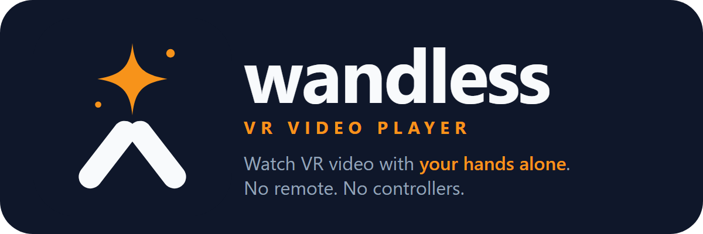

# Wandless VR Video Player

<p align="center"></p>

**Wandless** is a VR video player for the Meta Quest. It plays VR180 and flat video, and your hands are the whole remote:
no remote, no controllers. Stream from your laptop, or play a file stored on the headset.

**New here? Read [GUIDE.md](GUIDE.md):** setup, folders, the headset, gestures, passthrough, airplane mode.
This README is the technical reference.

## Why Wandless

- **Remote-free: your hands are the whole remote.** Pinch with two hands to zoom a VR180 picture, pinch with one hand to turn it or to
  move a flat screen, flick a hand to skip 30 s, double pinch for the menu, press your palms together to pause.
  Hands resting in your lap do nothing.
- **Nothing to install on the headset.** It runs in the Meta Quest Browser.
- **A Windows PC is the server, with no terminal.** Double-click to start. A control page in your browser shows the
  address to type on the headset, picks folders in the normal Windows folder window, and sets the passcode (a number
  keypad on the headset, with a lockout). Preview pictures too.
- **Passthrough videos work by themselves.** DeoVR-style videos with a packed mask, and videos with a filled background
  colour (green, violet, black), are found from their pictures (not their names) and cut out, so the person stands in
  your room.
- **Subtitles and audio tracks in VR.** Subtitle files next to the video, in a `Subs` folder, or inside the video;
  any audio track of the file, even the ones the browser cannot switch to. Your languages and your speed stay for the
  next video. Speed in 0.05 steps, from 0.5× to 3×.
- **No PC on the plane.** The whole player is one file that you save on the headset, and you can download videos
  from your library to the headset.

See **Similar projects** at the end for an honest comparison.

The whole app is ONE file: `dist/wandless.html` (page, player, three.js and the hand models, under 1 MB).
The laptop serves it. You can also copy it to the headset and use it with no network.

## Install (Windows)

1. Download `Wandless.exe` from the project's **Releases** page on GitHub.
2. Double-click it. The file is not signed, so Windows SmartScreen may say "Windows protected your PC": click
   **More info**, then **Run anyway**.
3. It installs itself for your Windows user, with no administrator rights: the program goes into
   `%LOCALAPPDATA%\Wandless`, a **Wandless** shortcut goes on the Desktop and in the Start menu, and Wandless shows
   in **Settings > Apps**. Then it starts in a new window. You can delete the downloaded file.

A downloaded file opened again installs itself only when it is newer than the installed copy. An older one starts the
installed copy instead: it never replaces a newer version. The installed copy is written as a new file (the program's
bytes only), so it does not carry the "downloaded from the internet" mark: SmartScreen warns once, on the download.

`Wandless.exe` is Node itself with the server and its pages inside (Node's single-executable feature), so nothing
else is needed: no Node, no Git, no terminal. ffmpeg stays optional (see **Previews**).
**Status (2026-11-04):** the built `Wandless.exe` was run through install, update, rollback and uninstall on one
Windows 11 PC (24 checks, twice). No other Windows version is tested yet. To build it yourself, see **Make a release**.
Everything Wandless keeps is in its folder: `Wandless.exe`, `folders.txt`, `.state\` (passcode hash, certificate,
previews, gesture log), and the pages it writes out at each start (`dist\`, `public\`, `scripts\`).

**Uninstall:** Settings > Apps > Wandless > Uninstall. It asks first, stops Wandless, then removes the shortcuts, the
Settings entry and the folder (your passcode, folder list and previews). Your videos stay. It removes a "Wandless"
shortcut only when that shortcut points to the installed program.

## Updates

**At each start, `Wandless.exe` asks GitHub for the latest release** (one request to `api.github.com`; GitHub sees
the PC's internet address, nothing else is sent). When it is newer, the window says so and the control page shows it,
with its notes. **Update now** then:

1. downloads the new `Wandless.exe` beside the running one (as `Wandless.new.exe`), and checks its size and its
   SHA-256 against what GitHub lists;
2. runs it once with `--self-test` (it starts its server on a free port and asks itself for the login page), so a
   file that cannot start on this PC never replaces the one that works;
3. renames the running file to `Wandless.old.exe` and puts the new one in its place (Windows lets a running program's
   file be renamed, not replaced);
4. closes this copy's ports and starts the new one in a new window. The new copy deletes the old file.

If the new version passes its self-test but then cannot start with your settings or ports, it puts the old file back,
starts it, and keeps itself as `Wandless.new.exe` (the next try overwrites it). The window then says "back on version".
Your folders, passcode, previews and certificate stay: they are not in the program file. A failed step leaves the
running file as it is, and **Update now** can be pressed again. The headset reloads the page after the restart.
GitHub is trusted as it is: there is no signature of our own. `VR_UPDATES=off` stops the check.
`lib/update.js` has the rules; `test/update.test.js` and `test/install.test.js` pin them.

From the source folder (below), Wandless never asks GitHub: update it with Git.

## Make a release

1. Raise `version` in `package.json` (x.y.z), and set `repository` to the GitHub repository (the update check reads it;
   `npm run package` refuses to build without it, because such a copy could never get an update).
2. Run `npm run package`. It needs **Node 25.5 or newer** (`node --build-sea`). With an older Node, run
   `node scripts/get-build-node.mjs` once first: it downloads the newest Node from nodejs.org, checks its SHA-256 against
   the list nodejs.org publishes, and unpacks it into `.tools\node\`, for building only (your Node stays as it is).
   `npm run package` then uses it. It writes `release\Wandless.exe` and prints its version, size and SHA-256. It puts
   `brand/wandless.ico` into the file as its icon (`scripts/exe-icon.mjs`; the build tool `resedit` does it, a dev
   dependency that never ships). The program inside is not touched.
3. Make a GitHub release with the tag `v<version>` and attach `release\Wandless.exe` under exactly that name. A release
   without the file shows on the control page as "has no Wandless.exe to download yet".

## Start from the source folder

**Double-click `Wandless` on the Desktop.** It runs `start-vr-player.cmd` in this folder. A window opens, and the
**control page** opens in your browser (`http://127.0.0.1:8440/`). To stop, press **Stop Wandless** there, or close
the window. Double-click the shortcut again while Wandless runs: it opens the control page again.
If the Desktop shortcut is lost, make a new one that points to `start-vr-player.cmd`.
This needs Node 22 or newer and `npm install` once. The certificate is made in JavaScript (`lib/cert.js`): no openssl.

The control page:

- shows the address to type on the headset, and when the headset last connected;
- asks for a passcode on the first start (until then the headset can open nothing), and changes it later.
  A change works at once, with no restart, and ends every open session;
- adds a folder (the Windows folder window, or a pasted path) and removes one;
- shows the preview and format-check progress, and downloads or clears the gesture log;
- shows the version, and offers a newer one (see **Updates**).

It answers only on 127.0.0.1, and only to requests that name `127.0.0.1` or `localhost` as the host, so a web page
cannot reach it through a DNS trick. Every change is a POST with an `X-VR-Player: 1` header: a page from another site
cannot send that header without asking first (a CORS preflight), and the control page never says yes.
`--control-port <n>` (or `CONTROL_PORT`) moves it, and `off` turns it off. `--no-open` (or `VR_OPEN=0`) keeps the
browser closed.

From a terminal instead:

```powershell
git clone https://github.com/cnghockey/wandless-vr-video-player
cd wandless-vr-video-player
npm install
npm start
```

- `npm start` builds the app, then starts Wandless with the passcode ON. Keep that window open.
- It serves the folders in `folders.txt` (see **Folders**). `--root "C:\path"` adds a folder for this run only.
- `npm run set-password` sets the passcode from a terminal (`npm run set-password -- --password` for letters).
  Restart Wandless after it: while Wandless runs, only the control page changes the passcode.
- `npm run start:open` starts with the password OFF. Use it only for a test.
- The window prints the laptop address for each network card. The headset must be on the same network as that card.
- If the headset cannot connect, allow Node.js on **Private** networks in Windows Firewall.

## Which address?

**Type only the laptop's address**, for example `192.168.1.20`. A small helper on port 80 sends the browser on to
`https://192.168.1.20:8443/`. Then **bookmark the page** (the star in the address bar), so you never type it again.

| The headset is on | Address |
|---|---|
| Your home Wi-Fi | the address the control page shows (it was `192.168.1.20`). It stays the same while the router keeps it. |
| The laptop's Mobile Hotspot (Windows Settings, Network, Mobile hotspot) | `192.168.137.1`: always the same |
| A guest or public Wi-Fi | Probably blocked: these networks often stop device-to-device traffic. Use the hotspot. |

- If the address ever changes (another network, or the router gave a new one), the control page shows the new one.
  To keep the home address fixed, reserve it for the laptop in the router settings (often "DHCP reservation").
- If port 80 is busy on the laptop, the window says so, and the control page shows the full `https://...:8443/`
  address. Type all of it. `HTTP_PORT=off` turns the helper off.

## On the headset, with the laptop

1. Turn on hand tracking in the Quest settings.
2. Open the Meta Quest Browser. Type the laptop address, or open your bookmark.
3. First visit only: the browser warns about the certificate. Tap **Advanced**, then **Proceed**.
4. Enter the passcode on the keypad. Pick a folder, then a video: its page opens over the list.
   For a file on the headset, open the **This headset** tab and tap **Choose a video**.
5. Check the picture settings (projection, 3D layout), and the audio and subtitles if the video has them.
   Tap **Watch in VR**, or **Watch in your room** for passthrough.

## Folders

`folders.txt` (in this folder) lists the video folders the headset may open, one per line. The headset shows them in
the **Folder** list. It can open their subfolders too, and **Search** looks in every subfolder.

- **Add a folder:** on the control page, press **Add a folder...** and pick it, or paste its path. Or add its path on
  a new line in `folders.txt` (quotes are fine). Then reload the page on the headset. Wandless does not need a restart.
- **Remove a folder:** press **Remove** on the control page, or delete its line. It closes at once.
- The first start with no `folders.txt` and no `--root` writes your Videos folder into it.
- A folder that is missing (for example a drive that is not plugged in) is skipped. The window lists it at start, and
  the control page marks it "not found".
- The headset can only open the folders in the list. It never sends a folder path: it sends a short id, and the
  laptop looks the id up in the list. Do not add a whole drive.
- The headset remembers the folder and subfolder you had open.
- **Order**: Name, Newest first, Oldest first, Largest first, Smallest first. The headset remembers it. "Newest" is the
  later of the file's creation and change times: a copied file counts from when it came to the PC. A folder sorts by
  its newest video and by the total size of its videos. Each card shows the size and the date.

## On the headset, with no laptop and no network (airplane mode)

1. Once, on Wi-Fi: open the player page, then the **This headset** tab, and tap **Download the player to this headset**.
   Or copy `dist\wandless.html` to the headset over USB, into the `Download` folder.
   To put a laptop video on the headset: pick it, then tap **Download this video to the headset**
   (`/media/<folder id>/<file>?download=1`, saved under its own name in `Download`). Or copy it over USB.
2. Later, in airplane mode: open the Quest Browser and go to `file:///sdcard/Download/wandless.html`.
3. Tap **Choose a video** and pick a file stored on the headset. Tap **Watch in VR**.

The offline copy has no library and no password. It reads only the file you choose, and a subtitle file if you add
one (**Add a file** on the video's page: SRT, WebVTT or ASS, read on the headset).
**Not proven on a Quest yet.** It is proven in a desktop browser with all network blocked.
Test it before a trip, at home, in this order. Each step tells you something:
1. Save the offline copy (step 1 above). Turn on airplane mode, with Wi-Fi off.
2. Type `file:///sdcard/Download/wandless.html`. Does the page open?
3. Tap **Choose a video**. Do you see your headset videos? (Before, the picker said "no files available for upload".)
4. Pick one and tap **Watch in VR**. Does it play in VR?
If a step fails, tell me which one. The fallback is a copy on a public web host with an offline cache.

## Controls

| Mode | Gesture | Result |
|---|---|---|
| VR180 | Pinch with both hands, spread apart | Zoom in |
| VR180 | Pinch with both hands, bring together | Zoom out |
| VR180 | Pinch with one hand, then move the hand | Turn the picture left, right, up or down |
| Flat | Pinch with one hand, then move the hand | Move the screen (it turns round you and follows your hand distance) |
| Flat | Pinch with both hands, spread or close | Resize the screen |
| Both | Flick your **right** hand quickly from the outside toward the centre, open hand (it moves left) | Skip forward 30 s ("+30 s >>" shows) |
| Both | Flick your **left** hand quickly from the outside toward the centre, open hand (it moves right) | Go back 30 s ("<< -30 s" shows) |
| Both | **Double pinch**: two quick pinches with one hand | The menu opens where you look. A double pinch closes it again. |
| Both | Point at a button, then pinch | Press it. Drag along the seek bar to scrub. |
| Both | Push a finger through a button | Press it (close range) |
| Both | Press the **X**, pinch anywhere that is not the menu, or look away from it | The menu closes |
| Both | Press **Home** on the menu | Close the video, leave VR and go back to the list |
| Both | **Prayer hands**: press both palms together, fingertips touching, held 0.2 s (a clap that stays), at chest height or higher | Pause or play ("Paused" / "Playing" shows). Part the hands before the next one. A quick clap, steepled fingers, clasped hands, a two-hand pinch and palms together in the lap never count. |

**Only a hand you can see counts.** A hand in the bottom quarter of your view (more than about 25 degrees below where
you look) does nothing: no pinch, zoom, turn, grab, swipe or menu. A hand on your leg does nothing, and when you look
straight ahead, a hand low at your chest does nothing too. Raise the hand into your view to use it. This follows your
head, so it also works when you sit back or lie down. A hand behind you or more than 90 cm away does nothing.
Prayer hands count lower, down to chest height (50 degrees below where you look): people press their palms together
there. The tracker tends to hold touching hands a little apart and can lose one for a moment; both are allowed for.

**Hands are drawn only while in use:** while a hand pinches or aims at the menu, and while the menu shows (and
always with the gesture numbers on). They fade out half a second after. They are smooth hand models
(`public/handmesh.js`: the WebXR Input Profiles generic hands, skinned to your joints by three.js), see-through with
brighter edges, orange while pinching. The models are inside the player file (no network). The old joint spheres show
until a model is ready, and with the gesture numbers on.

**Guards against accidents**
- A one-hand pinch must last 0.15 s, then travel 2 cm, before it moves the picture. A quick tap does nothing.
  The picture starts to move from that point, with no jump.
- The first hand of a two-hand zoom does nothing alone.
- After a two-hand zoom, the hand that is still pinching does nothing until it lets go.
- A hand that is pointing at the panel only clicks. It never zooms, turns or moves the picture.

**Swipe rules.** At least 15 cm in under 0.35 s (about 0.7 m/s or more), mostly sideways, with an open hand,
and only toward the centre of your body. The stroke back outward is ignored, so you do not skip twice.
After a swipe, the next one counts as soon as the hand has come back 4 cm (and 0.25 s have passed): quick repeated
flicks all count, and one long sweep counts once. Quick skips the same way add up on the message (+60 s, +90 s).
A pinching hand, a hand in the bottom quarter of your view and a hand pointing at the menu never swipe. Swipe with the hand in your view, at about chin height. Both hands moving in at the same time
(to press them together) is never a skip.

**The menu.** It shows for 5 s when VR starts, with "Double pinch opens this menu", so you know it is there. It does
this on the first 3 starts only (the count is kept on the headset): in the log of 2026-11-03, 5 of 5 start-up menus were
closed by a pinch after about 2.5 s.
It is about 32 by 13 degrees of your view (round 6: 38 by 30), 60 cm away and a little below where you look.
- Only a double pinch opens it. Until round 16, looking down opened it too: it came up when you did not want it
  (the headset log had 103 opens by looking down, 66 by a double pinch).
- It closes when you look away from it (more than about 35 degrees), even if a hand is resting on or near it, or 8 s
  after a hand last used it. Two short exceptions, 1.5 s each: just after it opened (your head is still moving), and
  while a pinch holds a button or scrubs the seek bar, or just after it let go. In the same log, 4 of 7 look-away closes
  came within 1.2 s of a press, and 4 of 7 were followed by a new double pinch within 3 s.
- The start-up menu closes after its 5 s. If a hand is on it then, it stays, as if you had opened it.
- A pinch with the ray just off the edge (within 5 cm) is a near miss: it presses nothing and does not close the menu.
- It always opens on its main page. Rows: Home, -10 s, play or pause, +10 s, X / the time, the seek bar, the length /
  −, the speed, +, then 1×, 1.25×, 1.5×, 1.75×, 2× / up to three buttons: **Subtitles** and **Audio** (only when the
  video has subtitles, or more than one audio track), **View**, then **Reset view** and **Passthrough** (room view only)
  while there is room.
- **View** page: Back, X / Picture: VR180, Fisheye, Flat screen / 3D: 2D, Side by side, Top-bottom / Reset view,
  Passthrough.
- **Subtitles** page: Off and the subtitles, six at a time (‹ › for more) / Earlier and Later: the timing in 0.5 s
  steps. **Audio** page: the audio tracks. Each list opens at the page that shows your choice.
- Layout: `panelLayout()` in `public/core.js`. The tests check that no two boxes overlap on any page.

**Speed.** − and + step by 0.05 (1.6× to 1.65×) from 0.5× to 3×. The presets stop at 2×. The page has the same
controls. The speed stays for the next video (`localStorage`, on the headset only).

**Gesture numbers.** Tick "Show gesture numbers in VR" on the page before you go in. A small plane under the panel then
shows: joints per hand, the thumb-to-index gap and `on` / `off` (in your view, or ignored); whether hand tracking is ON, the
kinds of input and what each pointer ray is aiming at; and the peak distance and speed of each hand's last swipe.
Send these numbers when a swipe misses or fires by accident.

## Passthrough (the real room behind the picture)

- Tap **Watch in your room** instead of Watch in VR. It is a different kind of session, so you choose it before you go in.
  The button shows only when the browser offers it.
- The room shows at once. A flat screen floats in your room. A VR180 picture covers your whole front view, so it
  becomes half see-through: you see the room through it. Zoom out with two hands to see the room round a smaller picture.
- **Passthrough videos with a mask** (DeoVR's `_alpha` format) are cut out: the person stands in your room, the rest is
  gone. Such a video is a pair of fisheye circles; each eye's mask is packed at 40 % size, in the red channel, in six
  pieces in the dark corners (`packedAlphaAt()` in `public/core.js` documents the layout; it matches two open-source
  packing tools, VRAutoMatte and vr2ar-converter-v3). The shader in `public/player.js` reads the mask back.
- **Passthrough videos with a filled background** (one even colour round the person, where a mask would be: often
  green, violet or black) are cut too. The colour goes, the person stays, and the edge is soft, with the colour's tint
  taken out of it. The video's page shows it under **Your room**: "Remove the green background" (on by itself),
  "Show all of the picture", and "Remove a black background" for a black one that was not found. The cut works on the
  colour as filmed: a colour by its CbCr distance from the background, black by its brightness. It starts just above
  the background's own noise (`findBackground()` and `backgroundKeep()` in `public/core.js`; the shader in
  `public/player.js` does the same sums). A black cut also takes the darkest shadows of the person: choose "Show all
  of the picture" if it takes too much.
- The server finds these videos from their pictures (`lib/layout.js`, ffmpeg: five frames, 128 × 64). Fisheye: black or
  mask-red corners, and a picture that fills its circles up to the edge. Filled background: in at least 3 of 5 frames,
  one colour fills 60 % of the band round the person (the top fifth of each eye and its outer strips). A colour must
  be even (spread 6 at most: a filled colour spreads 0 to 3, a real wall or sky 8 or more); for black the share
  decides (dark rooms fill 12 to 36 % of the band, black fills 66 to 100 %). A fisheye video gets no background
  check: its black corners look like a black background (they did on 4 of 5 real fisheye files).
  Measured on 30 VR videos (2026-10-28): the 5 filled ones found, none of the others. Results are kept in `.state\layouts.json`. The first folder is checked in the
  background at start. A name with `_alpha`, `FISHEYE190`, `MKX200` or `VRCA220` is also enough.
- A video stored on the headset: the page reads its pictures itself, the same way (`lookAtPictures()`: five frames
  from a hidden second copy of the video). If that fails, choose VR180 fisheye + the mask box, or a black background,
  by hand.
- The **Passthrough** button hides the room (black, like normal VR, the picture solid) and shows it again. It is on
  the main page in room view, and always on the View page.
- In a normal VR session the button is grey: "only in room view".
- Not proven on your headset yet: how the cut of a filled background looks, and the page's own picture check of a
  file on the headset (it decodes the video twice for a moment).

## Subtitles and audio tracks

**Subtitles.** The laptop offers three kinds (`GET /api/tracks/<folder id>/<file>` lists them):
- **Files** next to the video and named like it: `Film.srt`, `Film.en.srt`, `Film.eng.hi.srt`, `Film.fr.forced.srt`;
  in a `Subs` (or `Sub`, `Subtitles`) folder next to it, named like it, or any file there when the video is alone in
  its folder; and in `Subs/<the video's name>/`, as many downloads have them (`2_English.srt`). SRT, WebVTT, ASS/SSA.
  `lib/tracks.js` finds them. Links are skipped.
- **Text tracks inside the video** (SubRip, ASS, mov_text, WebVTT). ffmpeg must read the whole file to find them (they
  are spread through it), so ONE run takes out every text track. It starts when you open the video's page, so a
  choice in VR is quick. One video at a time. Kept in `.state\subtitles` (`lib/subtitles.js`).
- **Picture subtitles** (DVD, Blu-ray PGS) are counted, not offered: they would need text recognition.
- Text encodings: UTF-8, UTF-16 with a BOM, else Windows-1252 (many old French files). The words come as cues
  (`GET /api/subtitles/<folder id>/<file>?key=...`); a key must be one the tracks list named.
- Labels come from the language code (`eng`, `fre`, `fr-CA`; `.frc` = Canadian French, as Jellyfin reads it), the
  track title, the forced and SDH marks, or a language word in the file name. Your language comes first in the list.
- In VR: over the bottom of a flat screen (a line is about 7 % of the screen height); with VR180, 1.4 m in front of
  you, a little low, following where you look slowly. While the menu shows, just above it.
- **A video on the headset:** a web page can read only the files you pick, so it cannot find a subtitle file by itself.
  Pick the video and its subtitle files together in **Choose a video** (press and hold the first file, then tap the
  others), or add one later with **Add a file**. The language comes from the name: what follows the video's own name
  (`Film.en.srt`), else the language words at the end (`subtitleTag()` in `public/core.js`; a word of the movie title
  never counts: "Bad" in "Batman.Bad.Blood" is also a language code). Your remembered language chooses among them.
- **To take a laptop video's subtitles to the headset:** choose them on the video's page, then tap **Download these
  subtitles too**. The laptop sends them as an SRT file named like the video (`Film.eng.srt`, UTF-8):
  `GET /api/subtitles/<folder id>/<file>?key=...&download=1`.
- Subtitles inside a video work only from the laptop: the headset browser cannot read them out of a file.

**Audio tracks.** The headset browser plays ONE audio track of a file by itself, and has no way to switch
(`HTMLMediaElement.audioTracks` does not exist in it). It plays the first track of an MKV, and the track marked
default in an MP4 (measured in Chromium 156; an older browser may take the first, so the page is told it is not sure).
For any other track, the laptop decodes that track with ffmpeg to a WAV (16-bit stereo, 48 kHz, about 1.5 Mbit/s):
`GET /api/audio/<folder id>/<file>?stream=<n>` (`lib/audio.js`). A byte position in it IS a time, so the browser
seeks in it like in a file, and each range starts ffmpeg at that time. A track that starts late gets silence first.
The page mutes the video and plays the WAV with it: on a seek both move together; every 0.25 s it checks the gap, and
it plays the audio up to 5 % faster or slower below 0.15 s, or jumps above. Measured in Edge: the gap stays under
0.05 s after seeks, quick skips, a pause and at 1.65×.
The page remembers your audio language and your subtitle language (or Off) for the next video.

## Gesture log

When the laptop serves the page, the player keeps a short record of what your hands did, in
`.state\session-log.jsonl` on the laptop: how the menu opened and why it closed, button presses, each swipe with its
distance and speed, each pinch (on the menu, in view, or low), pinches from ignored hands, and while both hands are
close together, the palm and fingertip gaps and how low each hand is (`hands-near`). A low pinch or an ignored pinch
also logs how far below your line of sight the hand was (`below`, degrees) and how far from your head (`away`, cm), so
the line between "in view" and "low" can be moved from facts. A look-away close logs how far you looked (`deg`).
The swipe `speed` is a peak over single frames (a median of 7 m/s, more than a hand can do): use the distance.
It holds no video names.
After a session, ask me to read it: then the gestures are tuned from facts, not from memory. The file starts again
after 5 MB (the one before is kept as `session-log.old.jsonl`). The offline copy keeps no log.
Download or clear it on the control page.

## Previews

The video list shows a preview image for each video, made on the laptop with ffmpeg: one frame from 5 s in,
one eye only for 3D files. Previews for the first folder are made in the background when the server starts; the others
when you open them. They are kept in `.state\thumbs`.
The server looks for ffmpeg on the PATH, then in the Jellyfin folder. Set `FFMPEG_PATH` to the full path of `ffmpeg.exe`
if it is somewhere else. With no ffmpeg the list shows names only.
## Hands do not work?

- Use the **Meta Quest Browser**, the default one. In testing, **Wolvic** gave this page no hand data at all: only the
  Quest system icons showed when the palms faced the headset, and nothing could be pinched or pointed at.
- If the Meta Quest Browser still shows no hands: tap the icon at the left of the address bar, set Hand tracking to Allow, and reload.
- To see what the browser gives the page, tick "Show gesture numbers in VR" before you enter. On the plane under the panel,
  `hand-tracking OFF` or `inputs: none` means the browser gave the page no hands.

## Files

- Best: MP4 or WebM, H.264, H.265 or AV1 video, AAC audio. Meta lists AC3 and EAC3 sound as supported too.
- MKV: Chromium 156 plays MKV with H.264 and AAC, AC3 or EAC3 (tested in Edge). Meta's container list names only MP4,
  WebM and Ogg: **an MKV on the Quest is not proven yet.**
- DTS sound: the browser does not play the file at all (tested). Choose another audio track, or convert it.
- The layout is guessed from the file name: `180`, `LR`, `SBS`, `3dh` (side by side), `TB`, `OU`, `3dv` (top and bottom).
  Fisheye: `FISHEYE` / `FISHEYE190` (190 degrees), `MKX200` (200), `VRCA220` (220), and `alpha` (a packed mask, fisheye 190).
  A VR180 file with no layout word is guessed from its frame size, and the server's picture check finds fisheye files.
  Change it on the page or on the panel.

## Passcode or password (laptop mode)

- One passcode (digits: a number keypad on the login page) or one password (letters: a full keyboard). The server
  keeps only a hash, and the kind (`.state\auth.json`). A file from before passcodes counts as a password.
- Set it and change it on the control page. With no passcode yet, everything stays locked and the login page says
  to choose one on the laptop.
- A session lasts 12 hours (`VR_SESSION_HOURS`). The **Lock** button ends it.
- 5 wrong tries from one address lock it for 30 s. Each new wrong try doubles the lock, up to 15 min. With a 4-digit
  passcode, trying all 10,000 from one address would take about 3 months.
- Logout does not cancel a copied cookie. Change the passcode to end all sessions.

## Test

```powershell
npm test
npm run build
```

## Third-party parts

- [three.js](https://threejs.org) (MIT).
- The generic hand models of the [WebXR Input Profiles](https://github.com/immersive-web/webxr-input-profiles) project
  (MIT, (c) 2019 Amazon): `public/assets/hand-left.glb`, `hand-right.glb`, licence in `public/assets/LICENSE-hand-models.md`.
  The page footer credits both.

## Similar projects

[passthrough-theater](https://github.com/mortonbaker/passthrough-theater) (MIT) is the closest open-source project:
a LAN video server with a WebXR passthrough player for the Quest. Compared on 2026-10-25 from its README and code;
the subtitle, audio-track, speed and order rows added on 2026-10-27 from the same copy; our side of the passthrough
row updated on 2026-10-28.
Keep this table current: it is how a new user sees what each project is for.

| | Wandless | passthrough-theater |
|---|---|---|
| Input in VR | **Hand tracking**: pinch zoom and turn, flat screen move and resize, flick to skip, double pinch for the menu, palms together to pause | **Controllers**: laser and trigger, A/B buttons, sticks, grip. No hand tracking |
| Hands at rest | Ignored (the bottom quarter of your view) | Not applicable |
| Server | Windows: one `Wandless.exe` that installs itself (no Node, no administrator rights) and updates from GitHub with one button; a control page in the browser (address, folders with the Windows folder window, passcode). No terminal | Linux: Python, `install.sh`, systemd |
| Access | Passcode (number keypad) or password, lockout after wrong tries | None ("trusted network only") |
| Passthrough masks | DeoVR packed alpha (mask in the red corners of fisheye circles), and filled backgrounds (green, violet, black...: the colour is cut); both found from the pictures, also for a file on the headset | Its own top-bottom matte (`alphaPack: "tb"` in a sidecar file), and chroma key |
| Plain VR180 in passthrough | Half see-through; Passthrough on/off in VR | Chroma key over the room |
| Without the PC | The player saved on the headset as one file; videos downloadable to the headset | No |
| Library | Several folders, subfolders, search, previews; order by name, date or size | One media folder, thumbnails, an in-VR scene picker; order by title or length |
| Subtitles | Files next to the video or in a `Subs` folder, and the text subtitles inside the video; Earlier / Later in VR | None found in its code |
| Audio tracks | Any track of the file: the laptop sends it in time with the video | None found in its code (the browser's own track only) |
| Speed | − / + in 0.05 steps (0.5× to 3×), presets 1× to 2×, kept for the next video | One button: 0.5, 0.75, 1, 1.25, 1.5, 2×, kept |
| Other | Gesture log for tuning | DeoVR-compatible library feed, per-file settings saved from the headset, chapters, a voice assistant, a faststart check |

Ideas worth taking from it later: the in-VR library browser, per-file settings (zoom, position), chapters, the faststart
check, chroma key for green-screen videos.

## Not built yet

A chroma key for a real green screen (uneven, with shadows: the cut here is for even filled backgrounds), a cut for
fisheye videos with a filled background, a lens-exact MKX200 / VRCA220 model (they use the equidistant model at their
angle), VR360, controller input, resume position, a password on the offline copy, picture subtitles (DVD, Blu-ray),
subtitle size and colour settings, and an on-the-fly conversion for files the headset cannot play (DTS sound; MKV, if
the Quest does not play it). For `Wandless.exe`: a code signature (without one, SmartScreen warns on the first run), and a file description, so that
the Windows Firewall prompt and Task Manager say "Wandless VR Video Player" and not "Node.js".

## Logo

The icon is `brand/wandless-icon.svg`: two fingertips meeting in a pinch, with a spark where they touch (the magic, with no wand).
The PNG sizes, `wandless.ico` and the banner in `brand/` are made from it. The page icon is the same SVG, inside each page.

## Made by

Wandless is open source (MIT). It comes from the same people as [Sats4AI](https://sats4ai.com): AI tools that people and
AI agents pay for with Bitcoin over Lightning. No signup. No KYC.

Our other open source work is on [github.com/cnghockey](https://github.com/cnghockey). For example, the
[Sats4AI MCP server](https://github.com/cnghockey/sats4ai-mcp-server) and the
[L402 client examples](https://github.com/cnghockey/sats4ai-l402-examples). Check them out.
